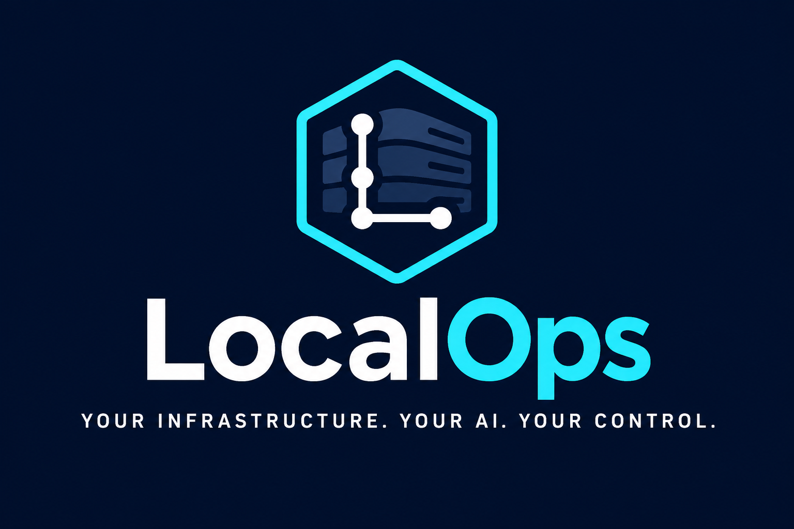
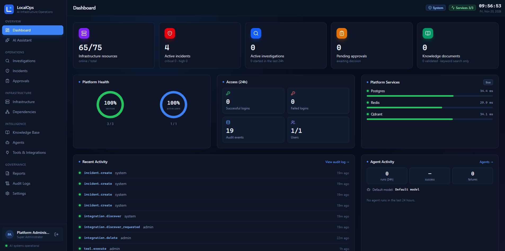
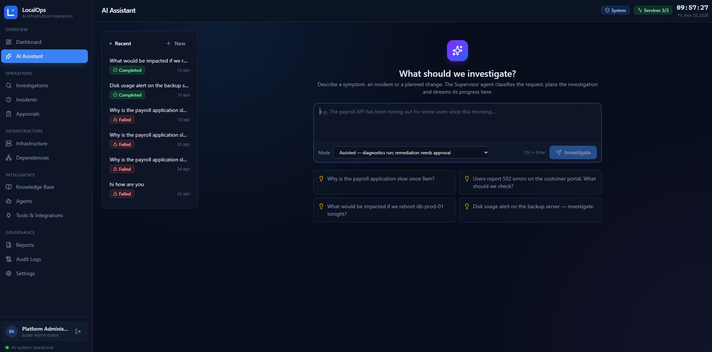
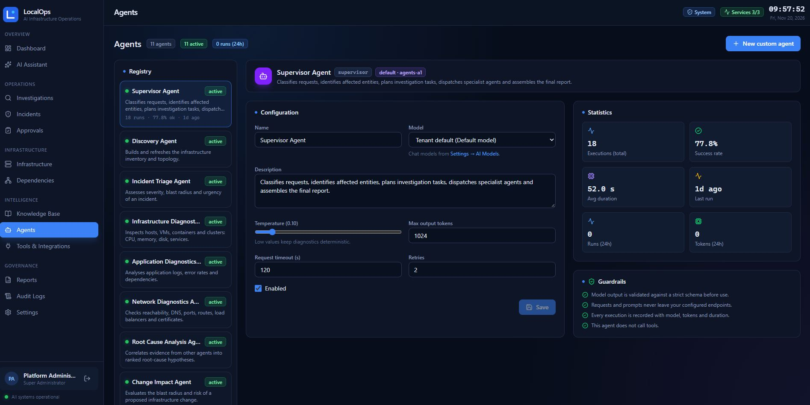
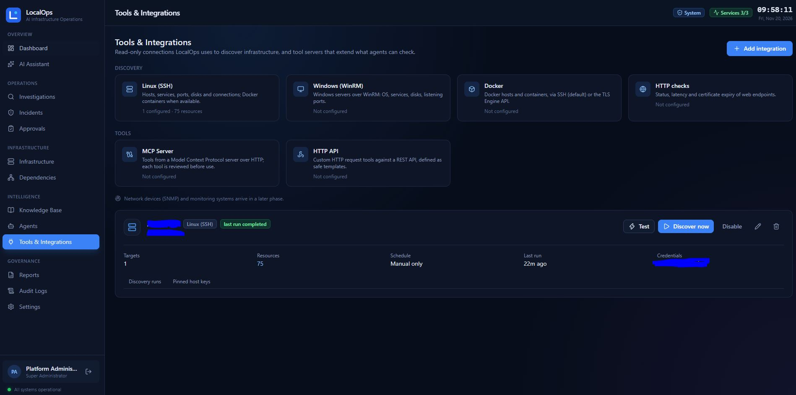
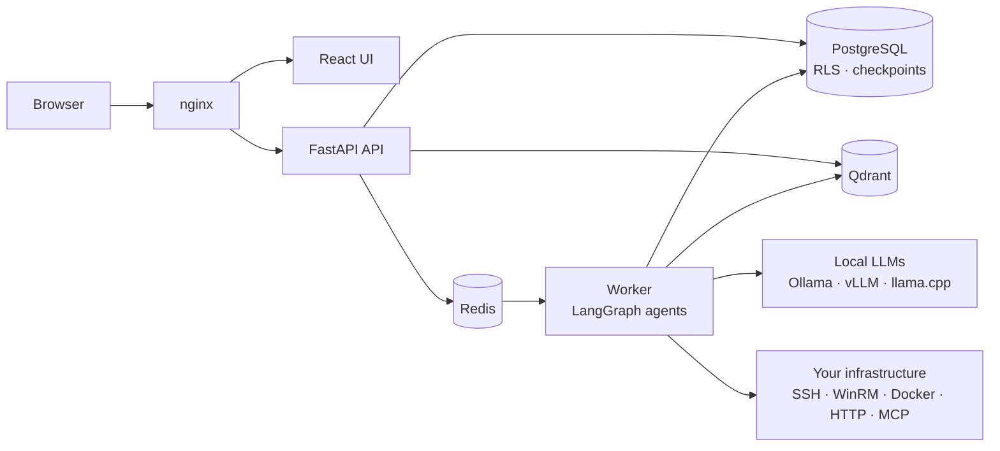

<div align="center">



### AI-powered infrastructure operations and troubleshooting, fully self-hosted

Investigate incidents with a team of AI agents, find root causes backed by evidence, and fix
problems through policy-controlled, approved remediation. Runs on your own hardware with your
own models, in connected or completely air-gapped environments.

<p>
  
  
  
  
  
  
</p>
<p>
  
  
  
  
  
  
</p>

[Features](#features) · [Screenshots](#screenshots) · [Quick start](#quick-start) ·
[Architecture](#architecture) · [Documentation](#documentation)

<br />



</div>

---

## Why LocalOps

Operations teams juggle dashboards, SSH sessions, runbooks and tribal knowledge when
something breaks. LocalOps brings these together. You describe the problem in plain
language, and a team of AI agents:

- investigates your real infrastructure with read-only tools;
- explains the root cause, citing the evidence it collected;
- proposes a fix that runs only after your policies and a second person approve it.

Everything stays inside your network: the models, the data and the audit trail.

<table>
  <tr>
    <td width="33%" valign="top">
      <h3>🔒 Private by design</h3>
      Self-hosted and multi-tenant, with row-level security in PostgreSQL. Works with local
      models (Ollama, vLLM, llama.cpp or any OpenAI-compatible server). No telemetry, no CDNs.
    </td>
    <td width="33%" valign="top">
      <h3>🧭 Evidence, not guesses</h3>
      Every finding and root cause cites the tool output or inventory data behind it.
      Unsupported conclusions are marked unverified.
    </td>
    <td width="33%" valign="top">
      <h3>🛡️ Safe by default</h3>
      Diagnostics are read-only. Changes go through policies, approvals with four-eyes,
      expiry, an execution gateway and automatic verification, all audited.
    </td>
  </tr>
</table>

## Features

<table>
  <tr>
    <td width="50%" valign="top">
      <h4>🤖 Multi-agent investigations</h4>
      A Supervisor classifies the request, plans the work and dispatches specialists:
      discovery, incident triage, infrastructure, application and network diagnostics,
      knowledge, change impact, root cause analysis, remediation planning and verification.
      Built on LangGraph, with durable PostgreSQL checkpoints and live progress streaming.
    </td>
    <td width="50%" valign="top">
      <h4>🗺️ Infrastructure discovery</h4>
      Read-only discovery of Linux (SSH), Windows (WinRM), Docker and HTTP endpoints.
      Builds an inventory with health, history, metrics and an interactive dependency graph
      with blast-radius analysis. Containers are grouped under their host.
    </td>
  </tr>
  <tr>
    <td valign="top">
      <h4>🔎 Diagnostics with tool calling</h4>
      Agents choose from read-only tools (processes, services, journal and event logs,
      container state and logs, HTTP, DNS and TCP checks). Output is redacted, budgeted and
      recorded for every run.
    </td>
    <td valign="top">
      <h4>🚨 Incident management</h4>
      Incidents open automatically when a resource turns unhealthy. Each has a timeline,
      linked investigations, similar-incident search and printable RCA reports.
    </td>
  </tr>
  <tr>
    <td valign="top">
      <h4>✅ Controlled remediation</h4>
      The Remediation Planner proposes registered actions (restart, start or stop services and
      containers, terminate a process, reboot), each tied to evidence. Policies decide risk and
      approval, and a Verification agent confirms the fix. An autonomous mode exists for
      low-risk actions your policies allow.
    </td>
    <td valign="top">
      <h4>📚 Knowledge base</h4>
      Upload runbooks (Markdown, text, PDF) or write them in the app. Resolved incidents and
      investigations are indexed automatically. Hybrid keyword and semantic search runs on
      Qdrant, and agents read knowledge as untrusted context, never as proof.
    </td>
  </tr>
  <tr>
    <td valign="top">
      <h4>🧩 MCP servers and custom tools</h4>
      Connect Model Context Protocol servers or define HTTP request tools against your REST
      APIs. New tools start disabled until an administrator reviews them and marks them read
      or change. Tool definitions are pinned, so a silent change disables the tool.
    </td>
    <td valign="top">
      <h4>⚙️ Configurable and custom agents</h4>
      Choose the model, limits, allowed tools and operator instructions for each agent, or
      create your own specialist agents. The Supervisor plans only agents that are enabled.
    </td>
  </tr>
  <tr>
    <td valign="top">
      <h4>👥 Multi-tenant RBAC</h4>
      Tenants, roles and fine-grained permissions, enforced in the API and the database.
      Local authentication with short-lived tokens and refresh cookies.
    </td>
    <td valign="top">
      <h4>📜 Full audit trail</h4>
      Logins, configuration changes, tool runs, approvals and executions are all recorded,
      with secrets redacted and credentials encrypted at rest.
    </td>
  </tr>
</table>

## Screenshots

<table>
  <tr>
    <td width="50%" valign="top">
      
      <p align="center"><b>AI Assistant</b><br /><sub>Describe a symptom, an incident or a planned change; agents investigate and stream progress live.</sub></p>
    </td>
    <td width="50%" valign="top">
      
      <p align="center"><b>Agents</b><br /><sub>Per-agent models, limits and tools, execution statistics, and custom agents.</sub></p>
    </td>
  </tr>
  <tr>
    <td width="50%" valign="top">
      
      <p align="center"><b>Tools &amp; Integrations</b><br /><sub>Discovery sources (Linux, Windows, Docker, HTTP) and tool servers (MCP, HTTP APIs).</sub></p>
    </td>
    <td width="50%" valign="top">
      
      <p align="center"><b>Operations Dashboard</b><br /><sub>Resources, incidents, investigations, approvals, knowledge and platform health at a glance.</sub></p>
    </td>
  </tr>
</table>

## Quick start

**Requirements:** a Linux host with Docker and Docker Compose, and an OpenAI-compatible model
server reachable from it (for example Ollama).

```bash
git clone https://github.com/mkamranr/localops.git
cd localops
cp .env.example .env
# Edit .env: replace every CHANGE_ME (APP_SECRET_KEY, DB passwords, BOOTSTRAP_ADMIN_PASSWORD)
# and set LOCALOPS_ENCRYPTION_KEY (the command to generate it is in the file)
docker compose up -d --build
docker compose ps            # all services healthy, "migrate" exited 0
```

Open `http://<host>:8300` and sign in with tenant **`system`**, username **`admin`** and your
`BOOTSTRAP_ADMIN_PASSWORD`. You'll be asked to change the password at first sign-in. Then:

1. **Settings → AI Models**: add a chat model, e.g. Ollama `qwen2.5:14b-instruct`. Optionally
   add an embedding model, e.g. `nomic-embed-text`, for semantic knowledge search.
2. **Tools & Integrations**: add your Linux, Windows, Docker or HTTP endpoints and run
   discovery.
3. **AI Assistant**: describe a problem, for example *"Why is the payroll API slow since
   9am?"*.

See the [installation guide](docs/installation.md) for details.

## Architecture



| Layer | Technology |
|---|---|
| API | FastAPI, async SQLAlchemy 2, Alembic, Pydantic |
| Agents | LangGraph with PostgreSQL checkpointing, a model gateway for OpenAI-compatible servers |
| Jobs | arq workers and cron on Redis |
| Data | PostgreSQL with row-level security per tenant; Qdrant for vectors |
| UI | React 18, TypeScript, Tailwind CSS, TanStack Query, Cytoscape |
| Deployment | Docker Compose behind nginx |

## Documentation

| Guide | What's inside |
|---|---|
| [Installation](docs/installation.md) | Configuration, first start, models, integrations, remediation prerequisites |
| [Architecture](docs/architecture.md) | Services, backend layout, data model, frontend |
| [AI orchestration](docs/ai.md) | Model gateway, agents, tools, investigation and remediation workflows |
| [Knowledge & extensibility](docs/knowledge.md) | Knowledge base, MCP servers, HTTP tools, agent configuration |
| [Security](docs/security.md) | Authentication, RBAC, tenant isolation, AI safety, secrets, audit |
| [REST API](docs/api.md) | Endpoints and permissions |

## Roadmap

| Phase | Scope | Status |
|---|---|---|
| 1 | Authentication, tenants, RBAC, audit, dashboard, Compose deployment | ✅ Done |
| 2 | Model gateway, agent registry, Supervisor, LangGraph investigations | ✅ Done |
| 3 | Infrastructure discovery, inventory, relationships and topology | ✅ Done |
| 4 | Diagnostics agents, root cause analysis, incidents | ✅ Done |
| 5 | Remediation planning, policies, approvals, execution gateway, verification | ✅ Done |
| 6 | Knowledge base, MCP servers, custom tools and agents | ✅ Done |
| 7 | Production images, offline bundle, model packaging, backup and restore | 🚧 Next |

## Development

Backend (Python 3.12, managed with [uv](https://docs.astral.sh/uv/)):

```bash
cd backend
uv sync
uv run ruff check . && uv run mypy app
uv run pytest tests/unit                      # no services needed
# Integration tests need PostgreSQL prepared by deployment/postgres/init/01-roles.sh:
LOCALOPS_TEST_DB=1 DB_HOST=localhost DB_OWNER_PASSWORD=... DB_APP_PASSWORD=... uv run pytest
```

Or run the full suite in containers:

```bash
docker compose -f docker-compose.test.yml run --rm --build tests
docker compose -f docker-compose.test.yml down -v
```

Frontend (Node 20):

```bash
cd frontend
npm ci
npm run dev          # proxies /api to http://localhost:8000 (override with LOCALOPS_API_URL)
npm run lint && npm test && npm run build
```

<details>
<summary><b>Repository layout</b></summary>

| Path | Contents |
|---|---|
| `backend/` | FastAPI app (`app/`), Alembic migrations, tests, Dockerfile |
| `frontend/` | React + TypeScript + Tailwind UI, Dockerfile |
| `deployment/` | nginx reverse proxy and PostgreSQL init scripts |
| `docs/` | Guides, screenshots and the logo (`docs/images/`) |
| `docker-compose.yml` | Full stack: postgres, redis, qdrant, migrate, api, worker, frontend, nginx |
| `docker-compose.test.yml` | Self-contained backend test stack |

</details>

## License

LocalOps is licensed under the [Apache License 2.0](LICENSE).
