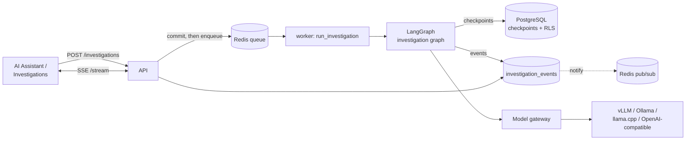

# AI Orchestration (Phase 4)

- **Phase 2:** the model gateway, the agent registry, the LangGraph investigation workflow with
  persistent checkpoints, and live progress streaming.
- **Phase 3:** connects investigations to the infrastructure inventory. Entities are verified
  against it, and the Discovery agent contributes inventory evidence.
- **Phase 4:** adds the diagnostics agents. They choose **read-only diagnostic tools** through
  model tool calling, and every tool run becomes cited evidence. A Root Cause Analysis agent then
  writes a report whose claims must cite that evidence.



## Model gateway (`app/llm/gateway.py`)

This is the only path to a language model. It speaks the OpenAI-compatible
`/v1/chat/completions` protocol over `httpx`. There is no LangChain or OpenAI SDK, no tokenizer
downloads and no telemetry.

- **Endpoint normalisation.** `http://host:11434` and `http://host:8000/v1` both work. Ollama
  health uses `/api/tags`; other providers use `/v1/models`.
- **Resilience.** Completions are streamed. The per-endpoint timeout limits how long the model
  may go *silent*, not the total generation time, so slow and thinking models can finish. The
  investigation as a whole is limited by `INVESTIGATION_TIMEOUT_SECONDS`. Retries with exponential
  backoff on connection errors, 429 and 5xx. Read timeouts and 4xx errors are not retried.
  Servers that reply with a plain JSON body instead of a stream also work. Optional fields
  (`stream_options`, thinking switches) are dropped once if the server rejects them with HTTP 400.
- **Structured output.** Requests a JSON object (`json_object`, `json_schema` or prompt-only, per
  endpoint). The prompt gives a plain field list and an example rather than a raw JSON Schema.
  Reasoning (`<think>…</think>`, a lone `</think>`, or a separate `reasoning_content` field) and
  code fences are stripped, then the reply is validated against a Pydantic schema. Near-miss
  values such as `"High"` or `"incident"` are normalised. If validation fails, the problem is fed
  back to the model up to twice. Invalid output never reaches the graph. On failure, the
  investigation error names the problem and shows the first 300 characters of the reply. That
  excerpt is not logged.
- **Thinking models.** Each endpoint has a *Reasoning* setting (Settings → AI Models):
  - `auto` (default): structured calls allow at least 4096 completion tokens. If a reply is
    cut off (`finish_reason=length`), it is retried with double the budget, up to 8192.
  - `enabled`: adds a further 4096 tokens for models that always think at length.
  - `disabled`: asks the server to turn reasoning off.
    - vLLM, SGLang and llama.cpp: `chat_template_kwargs.enable_thinking=false`.
    - Ollama: `think=false`.
    - Qwen3: also appends the `/no_think` hint.
    - If a server rejects the extra field with HTTP 400, the request is retried without it.
- **Tool calling.** `chat_tools` (`app/llm/tool_calling.py`) sends the read-only tools of an
  agent with the conversation. The model replies either with tool calls or with a final answer.
  Each endpoint has a *Tool calling* setting:
  - `native`: the OpenAI `tools` / `tool_calls` protocol. Streamed call fragments are
    reassembled.
  - `json`: for servers without tool support. The prompt lists the tools and asks for one JSON
    action, `{"tool": ..., "arguments": {...}}` or `{"final": ...}`.
  - `auto` (default): native first. If the server rejects `tools` with HTTP 400, it falls back
    to `json` and remembers that per endpoint and model. A JSON action written as plain text is
    also accepted.

  Small or older models often call tools badly. A model with dependable tool calling, such as
  Qwen2.5/Qwen3 14B or larger, gives much better investigations.
- **Accounting.** Prompt and completion tokens, call counts and latency go to Prometheus
  (`localops_model_*`) and to each agent execution record. Prompt and completion *content* is
  never logged.
- **API keys** are optional. They are stored encrypted with Fernet using
  `LOCALOPS_ENCRYPTION_KEY` and never returned by the API (`has_api_key` only).

Models are configured per tenant under **Settings → AI Models**:

- the first model becomes the default;
- each agent can be pinned to a specific model, or follow the default;
- **Test** lists the server's models and runs a one-token probe, then records health and
  latency.

## Agent registry (`app/agents/catalogue.py`)

All 11 agents from spec §11 are registered for every tenant. Bootstrap backfills them for existing
tenants. Each agent has `enabled`, an optional model, and limits: temperature, max tokens,
timeout and retries.

| Agent | Available | How it works |
|---|---|---|
| Supervisor | Phase 2 | LLM: classifies, clarifies and plans |
| Discovery | Phase 3 | Deterministic: inventory facts for each matched resource |
| Infrastructure Diagnostics | Phase 4 | LLM tool loop: hosts (CPU, memory, disk, processes, services, journal, event log) |
| Application Diagnostics | Phase 4 | LLM tool loop: containers and HTTP services (state, restarts, logs, health checks, recent changes) |
| Network Diagnostics | Phase 4 | LLM tool loop: DNS, TCP and HTTP reachability *from LocalOps* to inventoried resources |
| Knowledge | Phase 4 | Deterministic: similar past incidents and investigations (PostgreSQL full-text search plus shared resources). Runbooks and vector search come in Phase 6 |
| Incident Triage | Phase 4 | Deterministic: severity and priority from health, environment, blast radius and open incidents |
| Change Impact | Phase 4 | Deterministic: direct and indirect dependents, risk level, precautions, approvals |
| Root Cause Analysis | Phase 4 | LLM, after aggregation, with deterministic guards |
| Remediation Planner, Verification | Phase 5 | |

The Supervisor may plan tasks for any specialist. Tasks for agents that don't exist yet are
recorded as **skipped** with the reason. Root Cause Analysis is never planned; it always runs
after the specialists.

## Read-only diagnostic tools (`app/tools/`)

The tool catalogue is defined in code; the model cannot run anything outside it. Each tool has
a Pydantic argument model, applicable resource types, a timeout and an output cap. Commands are
built from fixed templates, with arguments checked by strict validators and then quoted.

| Area | Tools |
|---|---|
| Linux (SSH) | `linux_system_snapshot`, `linux_top_processes`, `linux_service_status`, `linux_journal`, `linux_failed_units` |
| Docker | `docker_container_state`, `docker_container_logs`, `docker_stats` |
| Windows (WinRM) | `windows_system_snapshot`, `windows_top_processes`, `windows_service_status`, `windows_event_log` |
| Network (from the worker) | `net_dns_lookup`, `net_tcp_check`, `net_http_check`; targets are restricted to inventoried resources |
| Inventory and history | `inventory_resource`, `inventory_dependencies`, `resource_metrics`, `recent_changes`, `search_similar_incidents` |

How a tool runs:

- Tools take a `resource_id` from the resources in scope. The executor loads the resource
  (through RLS), its integration, the decrypted credentials and the pinned host key. Containers
  are reached through their host's integration. The model never sees credentials.
- Output is redacted (passwords, tokens, `Authorization` headers, private keys,
  connection-string credentials, cloud keys) before it is stored or shown to a model. A model
  sees at most `TOOL_OUTPUT_MODEL_BYTES` of a result; about 16 KB is stored.
- Every run is a `tool_executions` row and an audit entry. A rejected call (unknown tool or
  invalid arguments) is recorded too, but it is not executed and gets no evidence id.
- **Limits:** `INVESTIGATION_MAX_TOOL_CALLS` per investigation (default 30), at most 2
  concurrent runs per host, and a timeout per tool.
- **Permissions:** remote tools run only if the user who started the investigation holds
  `tool.execute.readonly`. Otherwise the agents get the inventory tools only, and the report
  says so.
- **On demand:** the resource **Logs** tab runs the same tools through
  `POST /tools/{name}/run`.

## Diagnostics tool loop (`app/agents/toolloop.py`)

1. The agent gets its role, the objective, the in-scope resources and its allowed tools.
2. Each step, the model may make up to 4 calls, over at most 6 steps.
   - Repeated calls are answered from the earlier result.
   - Invalid calls are returned to the model as errors.
   - Each successful run becomes evidence `E<task>.<n>` and is fed back.
3. If the model stops without collecting anything, a small **baseline collection** runs for the
   resource type (for example the system snapshot and top processes), so findings always have
   evidence.
4. A second call turns the collected evidence into findings: observations
   (`confirmed_fact | observation`) and hypotheses, each with evidence ids.
5. Validation:
   - unknown evidence ids are dropped;
   - a claim with no supporting evidence becomes an unverified hypothesis;
   - a `confirmed_fact` must cite successful tool evidence.

Tool output is passed to the model as data and the prompt says so. The tools are read-only, so a
prompt injection in a log line can at most mislead the analysis. It cannot change a system.

## Root cause analysis (`app/agents/rca.py`)

The RCA agent receives the redacted evidence and the findings, and returns:

- the root cause, contributing factors and alternative hypotheses;
- impact, recommended remediation (advisory only) and preventive recommendations;
- evidence gaps.

Guards then apply, independent of the model:

- Evidence ids the RCA cites that do not exist are removed.
- `confirmed` requires at least **2** successful tool-evidence items and confidence **>= 0.7**.
  Otherwise the status becomes `probable`.
- A root cause citing no evidence becomes `unverified`, with confidence capped at 0.3. The report
  never presents it as the root cause; it is listed with the alternatives.
- With no evidence at all, no model call is made and the report states that no root cause could
  be established.

## Investigation workflow (`app/graphs/investigation.py`)

```
classify ─► clarify? (interrupt; at most INVESTIGATION_MAX_CLARIFICATIONS) ─► resolve_resources
         ─► plan_tasks ─► run_agent × N (parallel fan-out via Send) ─► aggregate
         ─► analyse_root_cause ─► report
```

- **classify** (LLM): request type, summary, affected entities, symptoms, urgency, confidence. It
  can request clarification.
- **clarify**: pauses the graph with a LangGraph `interrupt`. The investigation becomes
  `awaiting_input` until a user answers (`POST /investigations/{id}/resume`).
- **resolve_resources**: matches each entity against the inventory. An exact name, hostname,
  short hostname or IP resolves. A single partial match resolves and is marked `partial`.
  Several partial matches are reported as *ambiguous* with candidates. Matched resources are
  stored on the investigation (`resource_ids`) and shown as verified in the UI.
- **plan_tasks** also sees the matched resources (type, health, environment) as delimited data,
  and must include a Discovery task when any entity resolved.
- **Discovery agent** (no LLM): for each matched resource it returns stored facts as evidence:
  health and reasons, last-seen time and staleness, the disks, memory, services or containers
  behind the health status, upstream dependencies and the number of dependents.
- **plan_tasks** (LLM): 1–5 tasks. Unknown agents, duplicates and extras are dropped.
  Coverage is then ensured (up to 7 tasks):
  - triage for incident investigations;
  - Discovery;
  - for change-impact requests, Change Impact (the diagnostics are not added);
  - otherwise a diagnostics agent for each matched resource type, plus Knowledge (except for
    health checks).
- **Resources:** an investigation started from an incident, or with explicit `resource_ids`,
  uses those resources as already resolved.
- **run_agent**: each task runs its agent. Tool runs emit `tool.started` / `tool.completed` /
  `tool.failed`, and each finding emits `finding.recorded`. A model failure records the task as
  failed; it does not stop the investigation.
- **analyse_root_cause**: see above. Emits `rca.generated`.
- **report**: deterministic, with the spec §6.6 sections:
  - incident summary and timeline;
  - findings by kind;
  - recent changes, dependency analysis and change impact;
  - root cause, contributing factors and alternatives;
  - confidence, impact, remediation and prevention;
  - evidence gaps, triage and similar incidents;
  - the conclusion.
- **Incident write-back:** when the investigation belongs to an incident, its root cause and
  summary are written back to the incident, and both the start and the completion appear on the
  incident timeline.

Each instrumented node checks for cancellation, emits `agent.started`/`completed`/`failed`, and
writes an `agent_executions` row with model, tokens and duration.

Execution modes: `manual` and `assisted` behave the same in Phase 4, because only read-only
tools run. `autonomous` is rejected until the approval and policy engine exists (Phase 5).

## Durability and recovery

- Checkpoints are stored by `langgraph-checkpoint-postgres` after **every** step
  (`durability="sync"`). The schema is created by Alembic revision `0002`, never at runtime. The
  worker refuses to start if the library expects a newer schema.
- The thread id is `<tenant_id>:<investigation_id>`. RLS on `checkpoints`,
  `checkpoint_blobs` and `checkpoint_writes` compares that prefix with the session's tenant, so
  one tenant can neither read nor write another tenant's graph state.
- At startup the worker re-enqueues every `queued`/`running` investigation through the
  `worker_recoverable_investigations()` security-definer function. Re-running resumes from the
  last checkpoint, so completed steps (and their model calls) are not repeated. Re-running a
  finished investigation does nothing.
- A Redis lock (refreshed while running) prevents two workers from executing the same
  investigation. If the lock is held, arq retries the job later.
- A clarification answer survives restarts: the paused graph lives in PostgreSQL, and resuming
  works on any worker.

## Live events (SSE)

Every step appends to `investigation_events` with a gap-free per-investigation `seq` (assigned
under a row lock), then publishes a wake-up on `localops:t:<tenant>:investigation:<id>:events`.

`GET /investigations/{id}/stream` is a Server-Sent Events stream:

- replays events after `Last-Event-ID` (or `?after=`), then follows new ones;
- each SSE `id` is the event `seq`, and the `data` is the event JSON;
- sends `event: end` once the investigation is finished;
- keepalive comments every 15 s; it falls back to polling if Redis is unavailable;
- holds no database connection between reads, and every read goes through RLS.

The UI reads the stream with `fetch()` rather than `EventSource`, so the in-memory access token
can be sent as an `Authorization` header. The token is never put in a URL or cookie.
