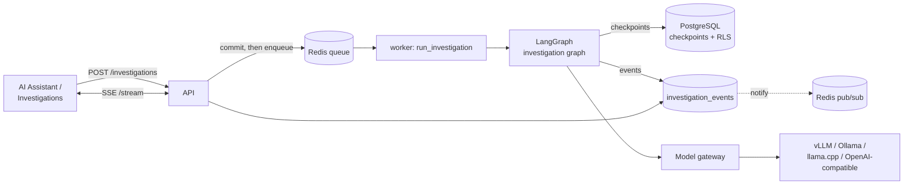

# AI Orchestration (Phase 3)

Phase 2 adds the model gateway, the agent registry, the LangGraph investigation workflow with
persistent checkpoints, and live progress streaming. Specialist diagnostic agents arrive in
later phases. Phase 3 connects investigations to the infrastructure inventory: entities are
verified against it, and the Discovery agent contributes inventory evidence.



## Model gateway (`app/llm/gateway.py`)

This is the only path to a language model. It speaks the OpenAI-compatible
`/v1/chat/completions` protocol over `httpx`. There is no LangChain or OpenAI SDK, no tokenizer
downloads and no telemetry.

- **Endpoint normalisation.** `http://host:11434` and `http://host:8000/v1` both work. Ollama
  health uses `/api/tags`; other providers use `/v1/models`.
- **Resilience.** Completions are streamed. The per-endpoint timeout limits how long the model
  may go *silent*, not the total generation time, so slow and thinking models can finish. The
  investigation as a whole is limited by `INVESTIGATION_TIMEOUT_SECONDS`. Retries with exponential
  backoff on connection errors, 429 and 5xx. Read timeouts and 4xx errors are not retried.
  Servers that reply with a plain JSON body instead of a stream also work. Optional fields
  (`stream_options`, thinking switches) are dropped once if the server rejects them with HTTP 400.
- **Structured output.** Requests a JSON object (`json_object`, `json_schema` or prompt-only, per
  endpoint). The prompt gives a plain field list and an example rather than a raw JSON Schema.
  Reasoning (`<think>…</think>`, a lone `</think>`, or a separate `reasoning_content` field) and
  code fences are stripped, then the reply is validated against a Pydantic schema. Near-miss
  values such as `"High"` or `"incident"` are normalised. If validation fails, the problem is fed
  back to the model up to twice. Invalid output never reaches the graph. On failure, the
  investigation error names the problem and shows the first 300 characters of the reply. That
  excerpt is not logged.
- **Thinking models.** Each endpoint has a *Reasoning* setting (Settings → AI Models):
  - `auto` (default): structured calls allow at least 4096 completion tokens. If a reply is
    cut off (`finish_reason=length`), it is retried with double the budget, up to 8192.
  - `enabled`: adds a further 4096 tokens for models that always think at length.
  - `disabled`: asks the server to turn reasoning off.
    - vLLM, SGLang and llama.cpp: `chat_template_kwargs.enable_thinking=false`.
    - Ollama: `think=false`.
    - Qwen3: also appends the `/no_think` hint.
    - If a server rejects the extra field with HTTP 400, the request is retried without it.
- **Accounting.** Prompt and completion tokens, call counts and latency go to Prometheus
  (`localops_model_*`) and to each agent execution record. Prompt and completion *content* is
  never logged.
- **API keys** are optional. They are stored encrypted with Fernet using
  `LOCALOPS_ENCRYPTION_KEY` and never returned by the API (`has_api_key` only).

Models are configured per tenant under **Settings → AI Models**:

- the first model becomes the default;
- each agent can be pinned to a specific model, or follow the default;
- **Test** lists the server's models and runs a one-token probe, then records health and
  latency.

## Agent registry (`app/agents/catalogue.py`)

All 11 agents from spec §11 are registered for every tenant. Bootstrap backfills them for existing
tenants. Each agent has `enabled`, an optional model, and limits: temperature, max tokens,
timeout and retries.

| Agent | Available |
|---|---|
| Supervisor | Phase 2 |
| Discovery | Phase 3 (available) |
| Incident Triage, Infrastructure / Application / Network Diagnostics, Root Cause Analysis, Change Impact | Phase 4 |
| Remediation Planner, Verification | Phase 5 |
| Knowledge | Phase 6 |

The Supervisor may plan tasks for any specialist. Tasks for agents that don't exist yet are
recorded as **skipped** with the reason.

## Investigation workflow (`app/graphs/investigation.py`)

```
classify ─► clarify? (interrupt; at most INVESTIGATION_MAX_CLARIFICATIONS) ─► resolve_resources
         ─► plan_tasks ─► run_agent × N (parallel fan-out via Send) ─► aggregate ─► report
```

- **classify** (LLM): request type, summary, affected entities, symptoms, urgency, confidence. It
  can request clarification.
- **clarify**: pauses the graph with a LangGraph `interrupt`. The investigation becomes
  `awaiting_input` until a user answers (`POST /investigations/{id}/resume`).
- **resolve_resources**: matches each entity against the inventory. An exact name, hostname,
  short hostname or IP resolves. A single partial match resolves and is marked `partial`.
  Several partial matches are reported as *ambiguous* with candidates. Matched resources are
  stored on the investigation (`resource_ids`) and shown as verified in the UI.
- **plan_tasks** also sees the matched resources (type, health, environment) as delimited data,
  and must include a Discovery task when any entity resolved.
- **Discovery agent** (no LLM): for each matched resource it returns stored facts as evidence:
  health and reasons, last-seen time and staleness, the disks, memory, services or containers
  behind the health status, upstream dependencies and the number of dependents.
- **plan_tasks** (LLM): 1–5 tasks. Unknown agents, duplicates and extras are dropped.
- **report**: deterministic. It records the classification, the verified resources, the plan,
  task outcomes, inventory evidence and the next steps. `root_cause` stays `null` until the
  Phase 4 diagnostic agents can support one. Nothing is fabricated.

Each instrumented node checks for cancellation, emits `agent.started`/`completed`/`failed`, and
writes an `agent_executions` row with model, tokens and duration.

Execution modes: `manual` and `assisted` behave the same in Phase 2 because nothing executes
against infrastructure yet. `autonomous` is rejected until the approval and policy engine exists
(Phase 5).

## Durability and recovery

- Checkpoints are stored by `langgraph-checkpoint-postgres` after **every** step
  (`durability="sync"`). The schema is created by Alembic revision `0002`, never at runtime. The
  worker refuses to start if the library expects a newer schema.
- The thread id is `<tenant_id>:<investigation_id>`. RLS on `checkpoints`,
  `checkpoint_blobs` and `checkpoint_writes` compares that prefix with the session's tenant, so
  one tenant can neither read nor write another tenant's graph state.
- At startup the worker re-enqueues every `queued`/`running` investigation through the
  `worker_recoverable_investigations()` security-definer function. Re-running resumes from the
  last checkpoint, so completed steps (and their model calls) are not repeated. Re-running a
  finished investigation does nothing.
- A Redis lock (refreshed while running) prevents two workers from executing the same
  investigation. If the lock is held, arq retries the job later.
- A clarification answer survives restarts: the paused graph lives in PostgreSQL, and resuming
  works on any worker.

## Live events (SSE)

Every step appends to `investigation_events` with a gap-free per-investigation `seq` (assigned
under a row lock), then publishes a wake-up on `localops:t:<tenant>:investigation:<id>:events`.

`GET /investigations/{id}/stream` is a Server-Sent Events stream:

- replays events after `Last-Event-ID` (or `?after=`), then follows new ones;
- each SSE `id` is the event `seq`, and the `data` is the event JSON;
- sends `event: end` once the investigation is finished;
- keepalive comments every 15 s; it falls back to polling if Redis is unavailable;
- holds no database connection between reads, and every read goes through RLS.

The UI reads the stream with `fetch()` rather than `EventSource`, so the in-memory access token
can be sent as an `Authorization` header. The token is never put in a URL or cookie.
