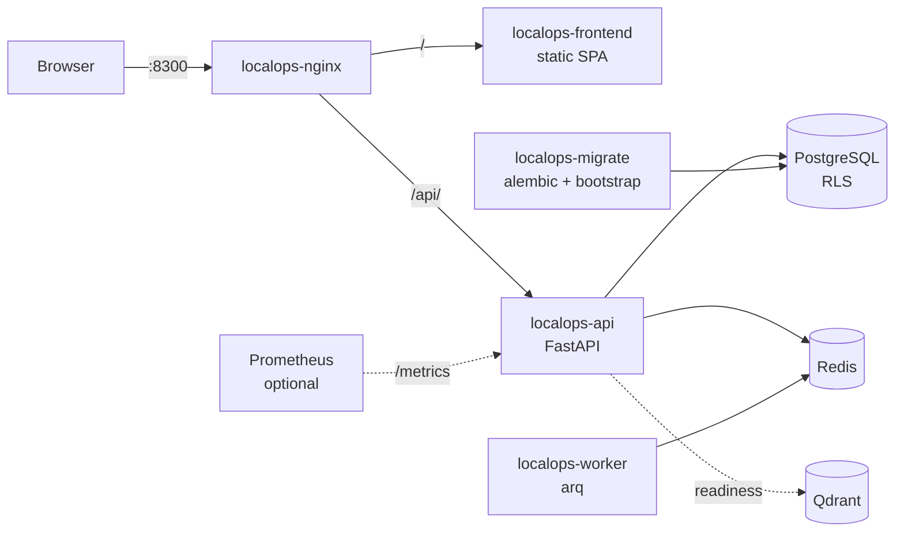

# Architecture (Phase 1)

LocalOps is a **modular monolith** (spec §25.1): one FastAPI backend image runs as `api`,
`worker` and the one-shot `migrate`. A static React bundle is served behind an nginx reverse proxy.



## Backend layout

```
backend/app/
├── main.py            app factory, middleware, routers, /metrics
├── cli.py             `python -m app.cli bootstrap`
├── worker.py          arq worker (heartbeat cron; real jobs from Phase 2)
├── core/              config, security (argon2/JWT/refresh), permissions catalogue,
│                      errors (JSON envelope), logging (structlog JSON), middleware, redis keys
├── database/          engine + tenant_session() (sets RLS context per transaction)
├── models/            SQLAlchemy 2 models: identity (tenants/users/roles/...), audit
├── repositories/      query functions (always under RLS)
├── services/          business logic: auth, tenants, users/roles, audit, dashboard, health
├── schemas/           Pydantic request/response models
└── api/               dependencies (get_context, require_permission) and v1 routers
```

Request flow for an authenticated endpoint:

1. `RequestContextMiddleware` assigns or propagates `X-Request-ID`, records Prometheus metrics,
   and writes a JSON access log.
2. `get_context` decodes the JWT, checks the Redis `jti` denylist, opens `tenant_session(tid)`,
   reloads the user, tenant and permissions from the DB, and yields a `RequestContext`.
3. `require_permission(...)` checks the principal's DB-loaded permissions.
4. The service runs inside the same transaction. It commits on success and rolls back on any
   error.

Errors always use the envelope
`{"error": {"code", "message", "details", "request_id"}}`. Lists use
`{"items", "total", "page", "page_size"}`.

## Data model (revision 0001)

`tenants`, `users`, `permissions` (global), `roles`, `role_permissions`, `user_roles`,
`refresh_tokens`, `audit_logs`, all with UUID keys and TIMESTAMPTZ columns. Two additions to
spec §9.1:

- `role_permissions`: needed to map roles to permissions.
- `tenant_id` on the join tables: so RLS and composite foreign keys can apply.

Users are soft-deleted (`status='deleted'`) so audit history and username reservations stay intact.

## Frontend

React 18, TypeScript, Vite, Tailwind v4, Radix primitives, TanStack Query and Zustand. It uses
system fonts only and runs fully offline.

- `src/api/client.ts`: typed fetch client with single-flight refresh on 401 and the error envelope.
- `src/layouts/navigation.ts`: the 13 sidebar entries (spec §12.1), filtered by permission and
  tagged with their delivery phase.
- Pages: Login, Dashboard, Audit Logs, Settings (Account, Users, Roles, Tenants), plus "planned"
  placeholders for screens arriving in later phases.

## Planned next (Phase 2)

Model gateway (vLLM, Ollama, OpenAI-compatible), LangGraph with PostgreSQL checkpointing,
supervisor agent, investigation execution, and SSE streaming. The nginx `/api/` location is
already unbuffered for SSE.
