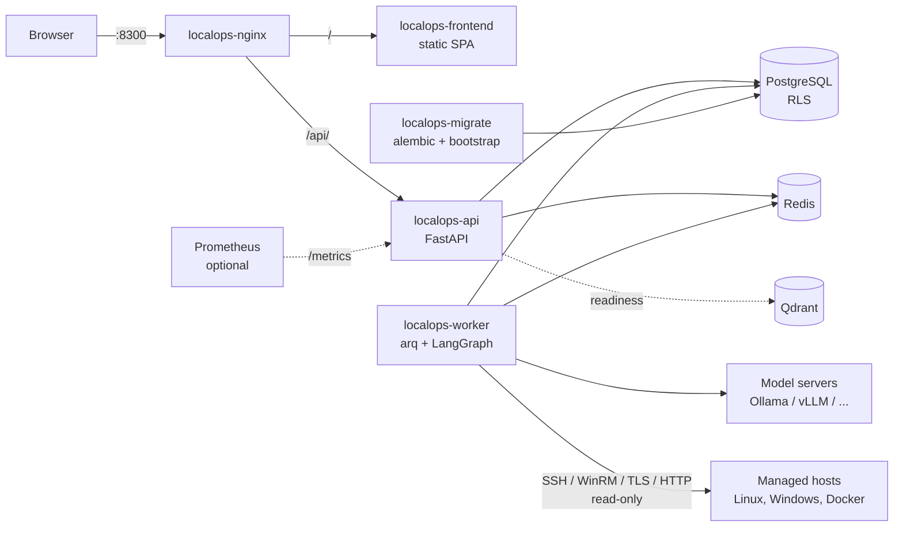

# Architecture (Phase 3)

LocalOps is a **modular monolith** (spec §25.1): one FastAPI backend image runs as `api`,
`worker` and the one-shot `migrate`. A static React bundle is served behind an nginx reverse proxy.



## Backend layout

```
backend/app/
├── main.py            app factory, middleware, routers, /metrics
├── cli.py             `python -m app.cli bootstrap`
├── worker.py          arq worker: investigation + discovery jobs, discovery scheduler cron,
│                      startup recovery, heartbeat
├── core/              config, security (argon2/JWT/refresh), permissions catalogue,
│                      errors (JSON envelope), logging (structlog JSON), middleware, redis keys
├── database/          engine + tenant_session() (sets RLS context per transaction)
├── models/            SQLAlchemy 2 models: identity, audit, ai (models/agents/investigations)
├── llm/               model gateway (OpenAI-compatible, structured output, metrics)
├── agents/            agent catalogue, Supervisor prompts/schemas, Discovery agent
├── integrations/      collectors: linux (SSH), windows (WinRM), docker (SSH/TLS), http;
│                      pure parsers + transports; SSH host-key pinning
├── discovery/         engine (upsert, diff, health, stale, relationships), scheduler
├── graphs/            LangGraph investigation graph, runtime, runner, checkpointer, events
├── repositories/      query functions (always under RLS)
├── services/          business logic: auth, tenants, users/roles, audit, dashboard, health
├── schemas/           Pydantic request/response models
└── api/               dependencies (get_context, require_permission) and v1 routers
```

Request flow for an authenticated endpoint:

1. `RequestContextMiddleware` assigns or propagates `X-Request-ID`, records Prometheus metrics,
   and writes a JSON access log.
2. `get_context` decodes the JWT, checks the Redis `jti` denylist, opens `tenant_session(tid)`,
   reloads the user, tenant and permissions from the DB, and yields a `RequestContext`.
3. `require_permission(...)` checks the principal's DB-loaded permissions.
4. The service runs inside the same transaction. It commits on success and rolls back on any
   error.

Errors always use the envelope
`{"error": {"code", "message", "details", "request_id"}}`. Lists use
`{"items", "total", "page", "page_size"}`.

## Data model (revision 0001)

`tenants`, `users`, `permissions` (global), `roles`, `role_permissions`, `user_roles`,
`refresh_tokens`, `audit_logs`, all with UUID keys and TIMESTAMPTZ columns. Two additions to
spec §9.1:

- `role_permissions`: needed to map roles to permissions.
- `tenant_id` on the join tables: so RLS and composite foreign keys can apply.

Users are soft-deleted (`status='deleted'`) so audit history and username reservations stay intact.

Revision `0002` adds `model_endpoints`, `agents`, `agent_executions`, `investigations`,
`investigation_events`, and the LangGraph checkpoint tables (all under RLS). See
[ai.md](ai.md) for the orchestration design.

Revision `0003` adds the inventory: `integrations`, `resources`, `resource_relationships`,
`discovery_runs`, `resource_events`, `resource_metric_samples` and `ssh_host_keys`, all under
RLS. It also adds the SECURITY DEFINER function `worker_due_integrations()`, which the scheduler
uses to find due work across tenants.

### Discovery

```
cron (every minute) ─► worker_due_integrations() ─► discovery_runs (queued) ─► run_discovery job
run_discovery: lock per integration ─► collect targets (bounded parallel, no DB session held)
             ─► apply_results: pin host keys · upsert by external_id · diff → resource_events
                · metric samples · health rules · mark unseen stale · derive relationships
```

Resources are identified by a stable `external_id`: `host:<machine-id>`,
`container:<host>:<name>`, `dockerd:<engine id>` or `http:<url>`. Rediscovery updates them
instead of creating duplicates. Dependency traversal (`/dependencies`, blast radius) is a
PostgreSQL recursive CTE with cycle protection. `DEPENDS_ON`, `RUNS_ON`, `CONNECTS_TO` and
`STORES_DATA_IN` point from dependent to dependency. `HOSTS` and `EXPOSES` point the other way.
`MONITORED_BY` and `MANAGED_BY` are not dependencies.

## Frontend

React 18, TypeScript, Vite, Tailwind v4, Radix primitives, TanStack Query and Zustand. It uses
system fonts only and runs fully offline.

- `src/api/client.ts`: typed fetch client with single-flight refresh on 401 and the error envelope.
- `src/layouts/navigation.ts`: the 13 sidebar entries (spec §12.1), filtered by permission and
  tagged with their delivery phase.
- `src/api/sse.ts`: fetch-based Server-Sent Events client (Authorization header, `Last-Event-ID`
  resume, backoff); `src/hooks/useInvestigationStream.ts` feeds the live timeline.
- Pages: Login, Dashboard, AI Assistant, Investigations (list + workspace), Infrastructure
  (list + resource detail), Dependencies (cytoscape.js topology, loaded on demand), Tools &
  Integrations, Agents, Audit Logs, Settings (Account, Users, Roles, AI Models, Tenants), plus
  "planned" placeholders for screens arriving in later phases.

## Planned next (Phase 4)

Diagnostic agents (incident triage, infrastructure, application and network diagnostics, root
cause analysis, change impact), log and metric collection tools, and incidents. Further
integrations (SNMP, Kubernetes, VMware, Proxmox, monitoring systems) follow in later phases.
