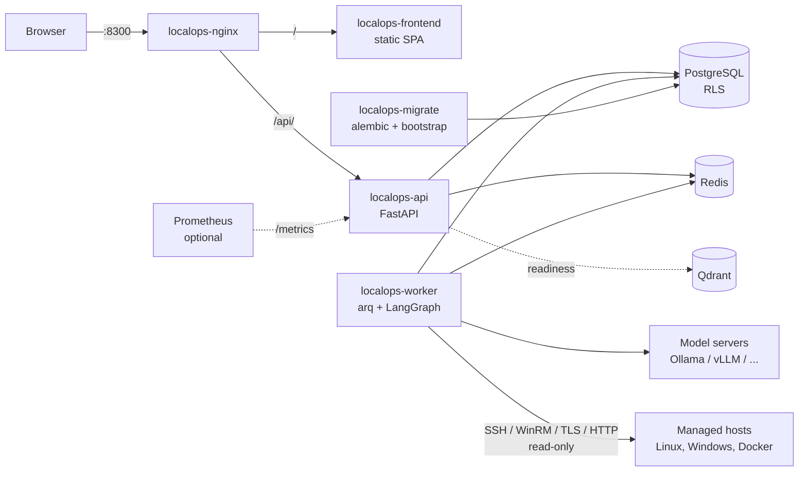

# Architecture (Phase 6)

LocalOps is a **modular monolith** (spec §25.1): one FastAPI backend image runs as `api`,
`worker` and the one-shot `migrate`. A static React bundle is served behind an nginx reverse proxy.



## Backend layout

```
backend/app/
├── main.py            app factory, middleware, routers, /metrics
├── cli.py             `python -m app.cli bootstrap`
├── worker.py          arq worker: investigation + discovery jobs, discovery scheduler cron,
│                      startup recovery, heartbeat
├── core/              config, security (argon2/JWT/refresh), permissions catalogue,
│                      errors (JSON envelope), logging (structlog JSON), middleware, redis keys
├── database/          engine + tenant_session() (sets RLS context per transaction)
├── models/            SQLAlchemy 2 models: identity, audit, ai (models/agents/investigations)
├── llm/               model gateway (OpenAI-compatible, structured output, tool calling)
├── agents/            agent catalogue, Supervisor, Discovery, diagnostics tool loop,
│                      assessments (knowledge, triage, change impact), RCA with guards
├── tools/             read-only diagnostic tool catalogue (Linux, Windows, Docker, network,
│                      inventory), executor (budget, per-host limit, audit), redaction
├── integrations/      collectors: linux (SSH), windows (WinRM), docker (SSH/TLS), http;
│                      pure parsers + transports; SSH host-key pinning
├── discovery/         engine (upsert, diff, health, stale, relationships), scheduler
├── graphs/            LangGraph investigation graph, runtime, runner, checkpointer, events
├── repositories/      query functions (always under RLS)
├── services/          business logic: auth, tenants, users/roles, audit, dashboard, health,
│                      incidents (status machine, automatic incidents), knowledge search
├── schemas/           Pydantic request/response models
└── api/               dependencies (get_context, require_permission) and v1 routers
```

Request flow for an authenticated endpoint:

1. `RequestContextMiddleware` assigns or propagates `X-Request-ID`, records Prometheus metrics,
   and writes a JSON access log.
2. `get_context` decodes the JWT, checks the Redis `jti` denylist, opens `tenant_session(tid)`,
   reloads the user, tenant and permissions from the DB, and yields a `RequestContext`.
3. `require_permission(...)` checks the principal's DB-loaded permissions.
4. The service runs inside the same transaction. It commits on success and rolls back on any
   error.

Errors always use the envelope
`{"error": {"code", "message", "details", "request_id"}}`. Lists use
`{"items", "total", "page", "page_size"}`.

## Data model (revision 0001)

`tenants`, `users`, `permissions` (global), `roles`, `role_permissions`, `user_roles`,
`refresh_tokens`, `audit_logs`, all with UUID keys and TIMESTAMPTZ columns. Two additions to
spec §9.1:

- `role_permissions`: needed to map roles to permissions.
- `tenant_id` on the join tables: so RLS and composite foreign keys can apply.

Users are soft-deleted (`status='deleted'`) so audit history and username reservations stay intact.

Revision `0002` adds `model_endpoints`, `agents`, `agent_executions`, `investigations`,
`investigation_events`, and the LangGraph checkpoint tables (all under RLS). See
[ai.md](ai.md) for the orchestration design.

Revision `0003` adds the inventory: `integrations`, `resources`, `resource_relationships`,
`discovery_runs`, `resource_events`, `resource_metric_samples` and `ssh_host_keys`, all under
RLS. It also adds the SECURITY DEFINER function `worker_due_integrations()`, which the scheduler
uses to find due work across tenants.

Revision `0004` adds:

- `incidents` (per-tenant numbers `INC-0001`, a status machine, a de-duplication key, a
  full-text search vector);
- `incident_resources`, and `incident_events` (an append-only timeline);
- `tool_executions` (every diagnostic tool run, with redacted output);
- `investigations.incident_id`.

All of these are under RLS. Incident numbers are allocated under a transaction-scoped advisory
lock.

Revision `0005` adds remediation:

- `policies` (per-tenant remediation rules, seeded with defaults);
- `approvals` (bound to an action hash, with a snapshot of the cited evidence, an expiry, and
  at most one pending request per plan step);
- `execution_jobs` (one per approval, with before/after state and the verification verdict);
- the investigation status `awaiting_approval`, and the SECURITY DEFINER function
  `worker_expired_approvals()` for the expiry sweep.

### Remediation

```
RCA ─► Remediation Planner ─► gateway.prepare (validate, policy) ─► approval (pending | auto)
    ─► graph pauses (interrupt) ─► approver decides ─► resume ─► gateway.execute_approved
    ─► execution_jobs + audit ─► Verification (verify tools, fixed rules) ─► incident status
```

### Investigations and incidents

```
discovery / health check ─► resource turns unhealthy ─► incident (source=discovery, dedup per resource)
incident ─► Investigate ─► investigation (incident's resources) ─► diagnostics agents ─► tools
        ◄── root cause + summary written back, timeline events ◄── RCA report
```

### Discovery

```
cron (every minute) ─► worker_due_integrations() ─► discovery_runs (queued) ─► run_discovery job
run_discovery: lock per integration ─► collect targets (bounded parallel, no DB session held)
             ─► apply_results: pin host keys · upsert by external_id · diff → resource_events
                · metric samples · health rules · mark unseen stale · derive relationships
```

Resources are identified by a stable `external_id`: `host:<machine-id>`,
`container:<host>:<name>`, `dockerd:<engine id>` or `http:<url>`. Rediscovery updates them
instead of creating duplicates. Dependency traversal (`/dependencies`, blast radius) is a
PostgreSQL recursive CTE with cycle protection. `DEPENDS_ON`, `RUNS_ON`, `CONNECTS_TO` and
`STORES_DATA_IN` point from dependent to dependency. `HOSTS` and `EXPOSES` point the other way.
`MONITORED_BY` and `MANAGED_BY` are not dependencies.

## Frontend

React 18, TypeScript, Vite, Tailwind v4, Radix primitives, TanStack Query and Zustand. It uses
system fonts only and runs fully offline.

- `src/api/client.ts`: typed fetch client with single-flight refresh on 401 and the error envelope.
- `src/layouts/navigation.ts`: the 13 sidebar entries (spec §12.1), filtered by permission and
  tagged with their delivery phase.
- `src/api/sse.ts`: fetch-based Server-Sent Events client (Authorization header, `Last-Event-ID`
  resume, backoff); `src/hooks/useInvestigationStream.ts` feeds the live timeline.
- Pages:
  - Login, Dashboard, AI Assistant;
  - Investigations (list, plus a workspace with live tool calls and the RCA report);
  - Incidents (list, plus detail with Overview, Investigation, Timeline, Diagnostics, RCA,
    Remediation, Related and Audit tabs);
  - Reports (printable RCA reports with a Markdown download);
  - Infrastructure (list, plus resource detail with live Logs and Incidents tabs);
  - Dependencies (cytoscape.js topology), Tools & Integrations, Agents, Audit Logs;
  - Approvals (pending and history, plus a detail page with the exact operation, evidence,
    policy and the decision buttons);
  - Settings (Account, Users, Roles, AI Models, Remediation Policies, Tenants).

  The heavier pages are loaded on demand. Phase 6 adds the Knowledge Base, Settings → Tools,
  a Tools tab on MCP and HTTP API integrations, and agent configuration with custom agents.

## Knowledge and extensibility (Phase 6)

See [knowledge.md](knowledge.md). Revision `0006` adds:

| Table | Purpose |
|---|---|
| `knowledge_documents` | Documents: type, source, status, tags, linked resources, version, index status |
| `knowledge_document_versions` | One row per saved version |
| `knowledge_chunks` | Chunks with a heading path and a full-text vector |
| `knowledge_feedback` | One vote per user and document |
| `tool_definitions` | MCP and HTTP tools per tenant: kind, risk, permission, enabled, status, schema hash and approved hash |

It also adds a `purpose` column (`chat` / `embedding`) to `model_endpoints`, the integration
types `mcp` and `http_api`, and the `tool.manage` permission.

Code:

- `app/knowledge/`: chunking, extraction, indexer, Qdrant access (`vectorstore.py`),
  hybrid search and prompt-injection delimiters (`safety.py`);
- `app/integrations/mcp.py`: our own MCP client (JSON-RPC over Streamable HTTP or SSE);
- `app/integrations/http_api.py`: template rendering with the URL confinement;
- `app/tools/catalogue.py`: the per-tenant catalogue, built-in plus usable registered tools,
  cached for 30 s;
- `app/tools/dynamic.py`: turns a definition into a `ToolSpec` validated with JSON Schema.

Qdrant holds one collection per embedding model. Every point carries `tenant_id`, and hits
are re-read under RLS.

Background jobs in the worker:

- `index_knowledge_document` (per change);
- `knowledge_sync` (every 5 minutes: generated documents and retries);
- `mcp_tool_sync` (hourly).

## Planned next (Phase 7)

- offline packaging, backup and restore;
- notifications (email and chat) for approvals and incidents;
- further integrations (SNMP, Kubernetes, VMware, Proxmox, monitoring systems).
